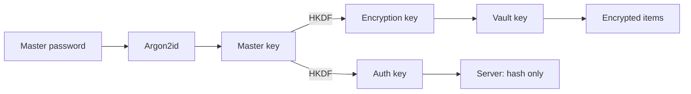
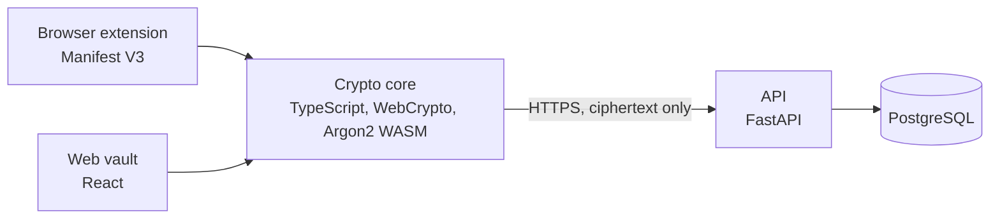

# zk-password-manager

A **zero-knowledge password manager**, web vault plus browser extension, built from scratch to learn and demonstrate **applied cryptography** and **secure software design**. Inspired by KeePass, Bitwarden and Dashlane.

> **Educational project, not audited.** Do not store real passwords before v1.0 and an independent review.

## Status

**Current milestone: M0, design.** Specifications, security design and threat model come first; code starts at M1. Progress is tracked in [ROADMAP.md](ROADMAP.md).

## Planned features

| Feature | Milestone |
|---|---|
| Client-side encrypted vault (logins, secure notes) | M1 to M3 |
| Password and passphrase generator with entropy display | M3 |
| Browser extension with origin-matched autofill | M4 |
| Auto-lock and clipboard clearing | M3, M4 |
| Optional TOTP second factor, breach check (Have I Been Pwned k-anonymity) | M5 |
| Encrypted export, KeePass import | M5, M6 |

## Security model in one picture

The server only ever stores **ciphertext** and a **hash** of a derived key. Full details in [docs/SECURITY_DESIGN.md](docs/SECURITY_DESIGN.md).

## Architecture

| Layer | Technology |
|---|---|
| Crypto core | TypeScript, WebCrypto API, Argon2id (WASM) |
| Web vault | React, Vite |
| Browser extension | Manifest V3, TypeScript |
| API | Python, FastAPI |
| Database | PostgreSQL |
| CI | GitHub Actions: tests, CodeQL, Gitleaks, Dependabot |

## Documentation

| Document | Content |
|---|---|
| [Specifications (cahier des charges)](docs/SPECIFICATIONS.md) | Goals, scope, use cases, functional and non-functional requirements, acceptance criteria |
| [Security design](docs/SECURITY_DESIGN.md) | Key hierarchy, cryptographic choices, flows, extension and server hardening |
| [Threat model](docs/THREAT_MODEL.md) | Assets, trust boundaries, adversaries, STRIDE analysis, residual risks |
| [Roadmap](ROADMAP.md) | Milestones M0 to M6 |

---

**Author:** Emmanuel Tankam Talla, cybersecurity engineering student (JUNIA ISEN). Licensed under MIT.
