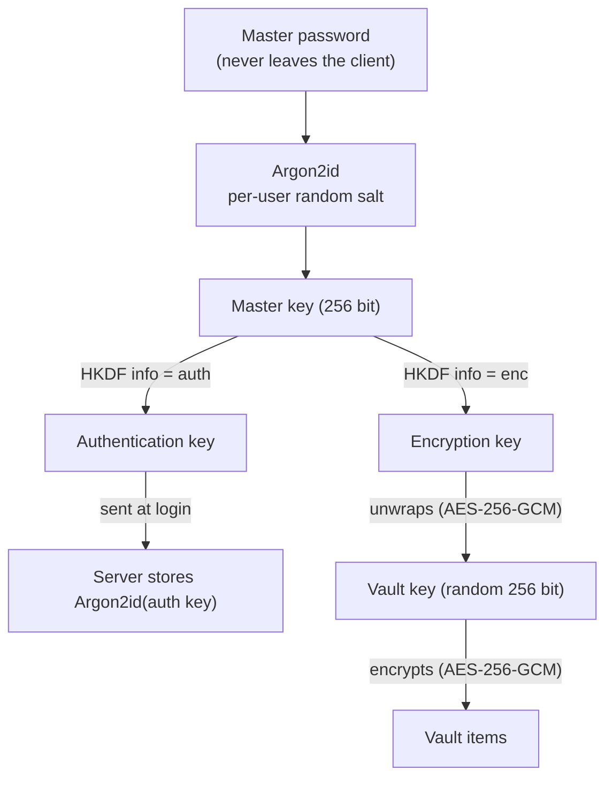

# Security design

> Draft for milestone M0. Parameters are reviewed at M1 against current OWASP guidance.

## Principles

1. **Zero-knowledge**: encryption and decryption happen only on the client.
2. **Separation of keys**: the key that proves identity to the server is never the key that encrypts data.
3. **Vetted primitives only**: Argon2id, HKDF-SHA-256, AES-256-GCM, CSPRNG from the platform.
4. **Defence in depth**: even with a full server compromise, an attacker gets only ciphertext and must brute-force an expensive KDF.

## Key hierarchy

| Element | Choice | Notes |
|---|---|---|
| Key derivation | Argon2id, starting point m = 64 MiB, t = 3, p = 1 | Tuned at M1 to meet NFR-06; parameters stored per user so they can be raised later |
| Salt | 16 random bytes per user | Returned by a pre-login endpoint |
| Key separation | HKDF-SHA-256 with distinct info labels | Encryption key and authentication key are independent |
| Vault key | 256 random bits from the platform CSPRNG | Generated at registration, stored only wrapped |
| Item encryption | AES-256-GCM, unique 96-bit random nonce per encryption | Item ID and version used as additional authenticated data, so ciphertexts cannot be swapped between items |
| Server-side auth hash | Argon2id of the authentication key | A stolen database does not allow logging in |

## Main flows

**Registration**: the client generates the salt and the vault key, derives the master key, wraps the vault key with the encryption key, and sends the email, salt, KDF parameters, auth hash input and wrapped vault key.

**Login and unlock**: the client fetches salt and KDF parameters, derives the master key, sends the authentication key, receives a session token and the wrapped vault key, then unwraps it locally.

**Master password change**: only the vault key is re-wrapped; items are untouched (FR-12).

**Lock**: keys are dropped from memory; the session token stays valid only for its short lifetime.

## Browser extension

- Manifest V3, minimal permissions, no remote code.
- Fill only on an exact match of the registrable domain and scheme, and only after a user action.
- No filling inside cross-origin iframes.
- Decrypted data kept in the extension context only, never injected into the page beyond the filled fields.
- Auto-lock and clipboard clearing (FR-08, FR-11).

## Server

- FastAPI behind HTTPS with HSTS; short-lived session tokens with rotation.
- Rate limiting and progressive lockout on pre-login and login.
- Input validation on every endpoint; the server treats every vault payload as opaque ciphertext.
- Structured logs without secrets; dependency and secret scanning in CI.

## References

- OWASP Application Security Verification Standard (ASVS)
- OWASP Password Storage Cheat Sheet
- NIST SP 800-63B, Digital Identity Guidelines
- Bitwarden Security Whitepaper, for comparison of design choices
