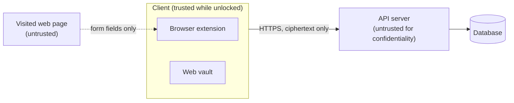

# Threat model

> Version 0.1 (M0). Reviewed at M5 against the implementation.

## Assets

| Asset | Why it matters |
|---|---|
| Vault items (passwords, notes) | The secrets the product exists to protect |
| Master password and derived keys | Give access to every item |
| Session tokens | Allow API access while the vault is unlocked |
| Account metadata (email, activity) | Personal data |

## Trust boundaries

The server is trusted for **availability**, never for **confidentiality**.

## Adversaries

| Adversary | Capability |
|---|---|
| Database thief | Obtains a full copy of the database |
| Malicious or compromised server | Serves modified responses, logs every request |
| Network attacker | Intercepts or alters traffic |
| Phishing website | Imitates a real site to receive filled credentials |
| Malicious script on a visited page | Reads or manipulates the page DOM |
| Online attacker | Tries passwords against the login endpoint |

## STRIDE analysis

| Threat | Example | Mitigation |
|---|---|---|
| **S**poofing | Phishing site asks the extension for credentials | Exact registrable-domain matching, fill on user action only |
| **S**poofing | Online password guessing | Expensive client KDF, rate limiting, lockout, optional TOTP |
| **T**ampering | Server swaps two encrypted items | AES-GCM with item ID and version as authenticated data |
| **T**ampering | Altered web vault code served by the server | Strict CSP, subresource integrity; extension shipped through the store (residual risk below) |
| **R**epudiation | User disputes a change | Account activity log (FR-17) |
| **I**nformation disclosure | Database leak | Only ciphertext and Argon2id hashes are stored |
| **I**nformation disclosure | Secrets in logs or crash reports | No secret ever logged; secret scanning in CI |
| **I**nformation disclosure | Password left in the clipboard | Automatic clipboard clearing |
| **D**enial of service | Login flooding | Rate limiting, KDF cost kept on the client |
| **E**levation of privilege | XSS in the web vault reads decrypted data | No inline scripts, strict CSP, output encoding, dependency audit |

## Residual risks (accepted for v1.0)

- A **compromised device** (keylogger, malware) can capture the master password: out of reach of any password manager.
- A **malicious server** could serve modified web vault code to a user of the web version. The browser extension, distributed through the store, reduces this risk.
- A **weak master password** stays brute-forceable offline after a database leak, only slowed down by Argon2id. The client enforces a strength check at registration.
- **No recovery**: a forgotten master password means the vault is lost, by design.
